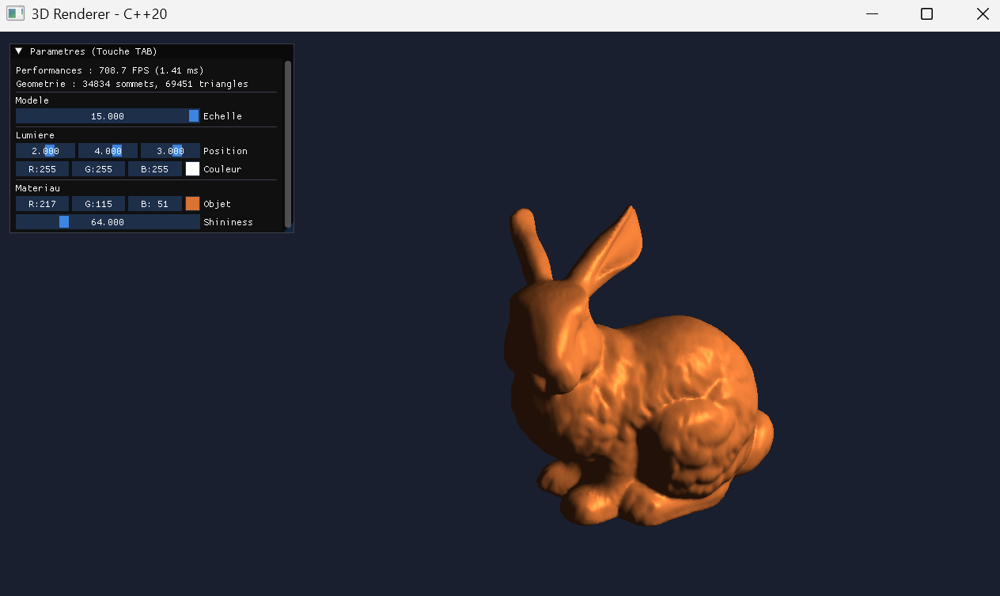

# Real-Time 3D Rendering Engine

[](https://github.com/victor-saunier/cpp-3d-renderer/actions/workflows/ci.yml)

A real-time 3D renderer written in C++20 with OpenGL 3.3 (Core Profile). It loads a Wavefront `.obj` model, lights it with Blinn-Phong shading, and lets you fly around it with a first-person camera while tuning the scene from a Dear ImGui panel.

<p align="center">
  
</p>

---

## Features

- **Model loading**: `.obj` files are parsed with tinyobjloader. Vertices with the same position and normal are merged, and the mesh is drawn with an index buffer (`glDrawElements`).
- **Normals**: normals from the file are used when a face has them. Missing ones are computed per vertex as the area-weighted average of the surrounding face normals (sum of cross products, normalized once).
- **Lighting**: Blinn-Phong (ambient + diffuse + specular), computed per fragment in world space in GLSL shaders.
- **GPU resource ownership (RAII)**: `Mesh` owns its VAO, VBO and EBO, and `Shader` owns its program. Both free them in their destructor and cannot be copied. Shader compile errors are printed with the file path, and a failed link throws an exception, so a broken shader stops the app instead of rendering nothing.
- **Camera**: first-person camera driven by yaw and pitch. Movement speed is scaled by frame time, so it doesn't depend on the framerate.
- **Debug panel (Dear ImGui)**: FPS and frame time, vertex and triangle count, model scale, light position and color, object color and shininess.

## Engineering

- **Unit tests** with GoogleTest: geometry math and the model loader (vertex deduplication, area-weighted normals, files mixing faces with and without normals).
- **Continuous integration** with GitHub Actions on every pull request:
  - Linux: GCC 13, built and tested inside the project's Docker image;
  - Windows: MSVC, built natively;
  - formatting check with clang-format.
- **Strict warnings** on the project's own targets (`/W4` on MSVC, `-Wall -Wextra -Wpedantic` on GCC), treated as errors in CI.
- **Dependencies** are downloaded by CMake (FetchContent): GLFW, glad, GLM, Dear ImGui, tinyobjloader, GoogleTest.

### Memory saved by indexing

Measured on the Stanford Bunny (69,451 triangles), with 24-byte vertices and 4-byte indices:

| Layout | Contents | Size |
| :--- | :--- | :--- |
| Without index buffer | 208,353 vertices (3 per triangle) | 5.0 MB |
| With index buffer | ~34,800 unique vertices + 208,353 indices | 1.7 MB |

That's about two thirds less GPU memory for the geometry. The vertex and triangle counts are shown in the debug panel.

---

## Project Structure

```text
cpp-3d-renderer/
├── assets/
│   └── cube.obj              # Bundled fallback model
├── shaders/
│   ├── basic.vert            # Model-view-projection transform, normals to world space
│   └── basic.frag            # Blinn-Phong lighting
├── src/
│   ├── Camera.hpp            # First-person camera (view matrix, keyboard and mouse input)
│   ├── GeometryMath.hpp      # Triangle normal computation
│   ├── Mesh.hpp/.cpp         # RAII wrapper for VAO, VBO and EBO
│   ├── ModelLoader.hpp/.cpp  # OBJ loading, vertex deduplication, normal generation
│   ├── Shader.hpp/.cpp       # Shader compilation, linking and uniforms
│   ├── Vertex.hpp            # Vertex layout (position + normal), no OpenGL dependency
│   └── main.cpp              # Window, render loop and ImGui panel
├── tests/
│   ├── data/                 # Small .obj files used by the tests
│   ├── test_geometry.cpp
│   └── test_model_loader.cpp
├── .github/workflows/ci.yml  # CI pipeline
├── .clang-format             # Code style
├── Dockerfile                # Reproducible Linux build and test run
└── CMakeLists.txt
```

---

## Build and Run

### Prerequisites
- A C++20 compiler: GCC 13+ (Linux) or Visual Studio 2022+ (Windows).
- CMake 3.25+, Git, and Python 3 (glad generates its OpenGL loader with Python during configuration).
- A GPU and driver supporting OpenGL 3.3 Core Profile.
- On Linux, the X11 and OpenGL development headers (the exact package list is in the [Dockerfile](Dockerfile)).

### Linux (GCC)
```bash
cmake -B build -DCMAKE_BUILD_TYPE=Release
cmake --build build
./build/RendererApp
```

### Windows (MSVC, PowerShell)
```powershell
cmake -B build
cmake --build build --config Release
.\build\Release\RendererApp.exe
```

### Choosing a model
The app loads, in order: the path given as first argument, then `assets/model.obj` (git-ignored, bring your own), then the bundled `assets/cube.obj`. Shader and asset paths are resolved from the source directory, so the executable can be launched from any working directory.

```bash
./build/RendererApp path/to/model.obj
```

### Running the tests
```bash
ctest --test-dir build --output-on-failure            # Linux
ctest --test-dir build -C Release --output-on-failure # Windows
```

### Docker (Linux build and tests, no GPU or display needed)
```bash
docker build -t cpp-3d-renderer .
docker run --rm cpp-3d-renderer
```

### Formatting
```bash
uvx clang-format==22.1.3 -i src/*.cpp src/*.hpp tests/*.cpp
```

---

## Controls

| Input | Action |
| :--- | :--- |
| W / Z | Move forward |
| S | Move backward |
| A / Q | Move left |
| D | Move right |
| Mouse | Look around |
| TAB | Switch between camera control and the ImGui panel |
| ESC | Quit |

Both QWERTY (WASD) and AZERTY (ZQSD) layouts work.
